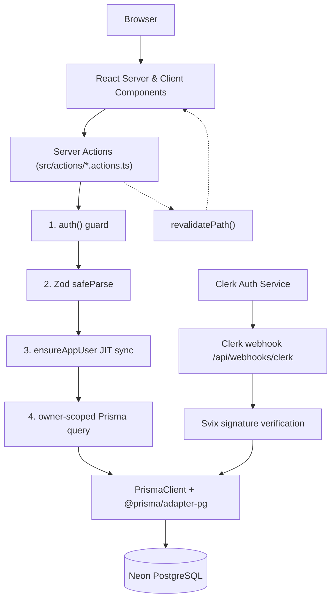
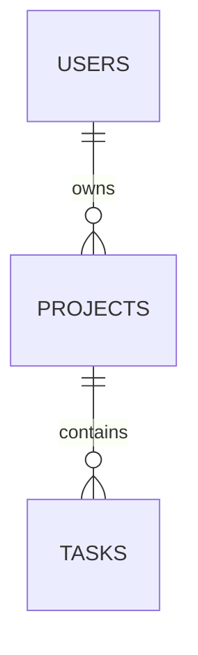
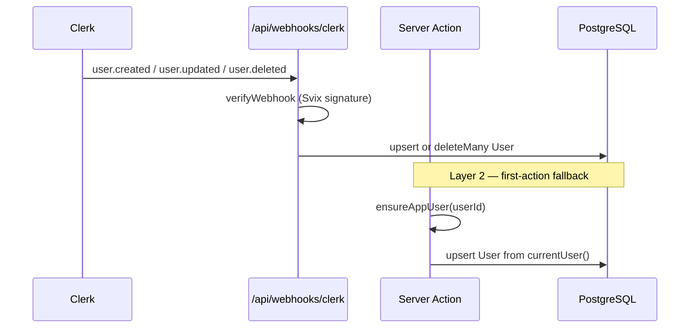
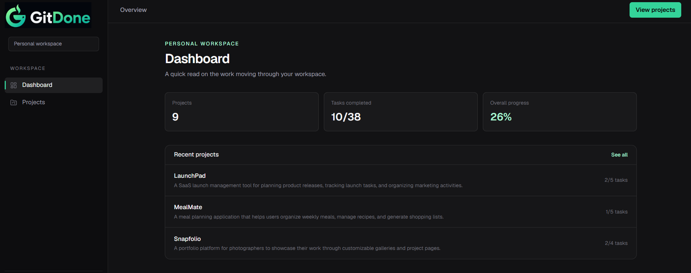
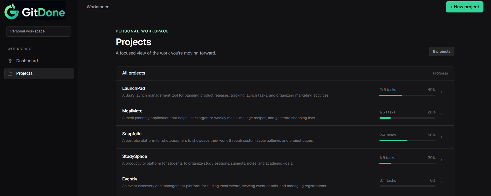
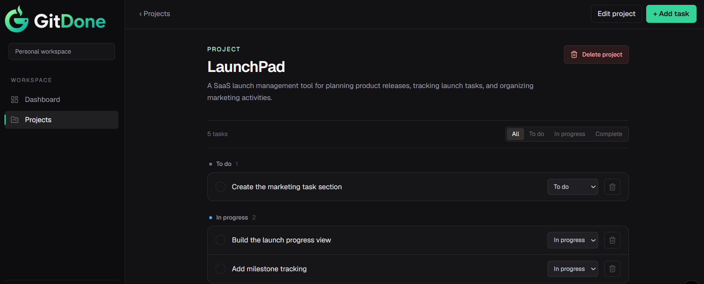

# GitDone

> **A calm, dark workspace for moving meaningful work to done.**

[Product vision](#product-vision) · [MVP scope](#mvp-scope) · [Architecture](#architecture) · [Data model](#data-model) · [Roadmap](#delivery-roadmap) · [Coding standards](./coding-standards.md)

> [!NOTE]
> This is the product-level context document. The engineering detail lives in [`docs/ARCHITECTURE.md`](../docs/ARCHITECTURE.md), the product requirements live in [`docs/git-done-prd.md`](../docs/git-done-prd.md), and the visual language lives in [`UI_DESIGN_SYSTEM.md`](../UI_DESIGN_SYSTEM.md). If a decision here conflicts with one of those, update both in the same change.

---

## Product vision

Enterprise project tools (Jira, Asana, Monday) are built for coordinating many people. A solo developer, freelancer, or technical creator pays the full complexity cost of that coordination for none of its benefit — and ends up doing project management instead of the work.

GitDone removes the ceremony. It serves one productivity loop, end to end:

**Create a project → add actionable tasks → move each task to completion.**

Everything in the product exists to make that loop fast, legible, and pleasant on a dark, low-noise canvas. The result is a workspace that feels like Linear's clarity with the personal-workspace warmth of Notion, without bloat, without configuration, and without a learning curve.

**Status:** Completed MVP, deployed and in production. See [Delivered](#delivered-in-the-mvp) and [Delivery roadmap](#delivery-roadmap).

### Product principles

1. **One loop, zero configuration.** A user should never configure GitDone before working in it. A project needs a name; a task needs a title. Nothing else is required.
2. **Execution over ceremony.** There is no backlog grooming, no workflow builder, no field administration. Status is the only workflow dimension, and it is three states wide.
3. **Instant by construction.** Reads are server-rendered; mutations are Server Actions with optimistic pending states and targeted cache revalidation. The UI never sits in an unexplained loading state after an action.
4. **Calm, dark, accessible.** Dark-first by design, restrained emerald accent, borders instead of shadows. Accessibility — keyboard reach, focus visibility, ARIA semantics, reduced motion — is an acceptance criterion, not a later phase.
5. **Strictly private by default.** Every project and task is owned by exactly one Clerk user and is scoped to that owner in every query. There is no sharing surface, so there is no sharing leak.

## Who it serves

| Persona | Job to be done | What they put in GitDone |
| --- | --- | --- |
| Solo developer (primary) | Know what I'm working on and what's next to finish | 3–10 concurrent side projects with a handful of tasks each |
| Freelancer / contractor | Track several client engagements without a client-facing PM tool | Client-named projects with deliverable-style tasks |
| Technical creator | Keep personal initiatives moving between other commitments | Content, learning, and infrastructure projects |

The primary persona checks the workspace from a laptop and occasionally from a phone. Every screen must hold up at a narrow mobile width.

## MVP scope

### Delivered in the MVP

| Area | Delivered |
| --- | --- |
| **Marketing** | Landing page at `/` with hero, value proposition, and an interactive preview |
| **Auth** | Clerk email/social sign-in and sign-up at `/sign-in` and `/sign-up`, dark-themed, with server-side route protection |
| **User sync** | Dual-layer identity sync: Svix-verified Clerk webhook plus just-in-time fallback |
| **Dashboard** | Workspace summary — total projects, completed/total tasks, overall completion percentage — plus a recent-projects list |
| **Projects** | Full CRUD with Zod validation, a responsive list with live progress bars, and modal dialogs |
| **Tasks** | Full CRUD, automatic grouping by status, inline status change, and client-side status filter tabs |
| **Isolation** | Ownership enforced at the query level for every read and write |
| **UI** | Dark design system with emerald brand accents, persistent desktop sidebar, mobile navigation sheet, accessible dialogs |

### Core workflows

| Workflow | Outcome |
| --- | --- |
| Create | Open a modal, give a project a name and optional description. |
| Plan | Add tasks with a title and optional description directly inside a project. |
| Execute | Move tasks through **To Do → In Progress → Complete** from a status control or dropdown. |
| Review | Filter the board by status; read overall progress on the dashboard and the projects list. |
| Maintain | Edit project metadata, rename or re-describe a task, or delete either with confirmation. |
| Remove | Delete a project with a confirmation step; its tasks are cascade-deleted. |

### Task status

Status is the only workflow dimension. It is a fixed enum — users cannot add states.

| Status | Meaning | Visual |
| --- | --- | --- |
| `TODO` | Not started | Muted dot / `text-zinc-400` |
| `IN_PROGRESS` | Actively being worked | Blue indicator / `text-blue-300` |
| `COMPLETE` | Done | Emerald indicator, strikethrough title |

> [!NOTE]
> Status is never signalled by color alone — each status carries a text label in its dropdown and a distinct indicator.

### Routes

| Route | Purpose |
| --- | --- |
| `/` | Marketing landing page |
| `/sign-in/[[...sign-in]]` | Clerk sign-in (optional catch-all for multi-step auth) |
| `/sign-up/[[...sign-up]]` | Clerk sign-up |
| `/dashboard` | Workspace overview: metrics and recent projects |
| `/projects` | All projects with progress bars |
| `/projects/[projectId]` | Project workspace and task board |
| `/api/webhooks/clerk` | Clerk user lifecycle webhook (POST; GET is a reachability ping) |

All `/dashboard` and `/projects` routes are protected server-side by `await auth.protect()` in `src/app/(dashboard)/layout.tsx`. A project URL is a locator, never an authorization mechanism — ownership is always re-checked in the query.

### Explicitly deferred

These are deliberately **not built**. Do not assume or scaffold them without a product decision:

- Drag-and-drop task board (Kanban column dragging)
- Due dates and milestones
- Labels, tags, and priorities
- Search and sorting across projects and tasks
- Shared or team workspaces, roles, and permissions
- Activity log and audit history
- Keyboard shortcuts / command palette
- Import and export of workspace data

## Architecture

GitDone is **server-first and zero-REST**: there is no internal API layer. Next.js **Server Actions** are the type-safe mutation boundary; Server Components read data directly.



### Recommended stack

| Layer | Technology | Role |
| --- | --- | --- |
| Framework | [Next.js 16](https://nextjs.org/) (App Router) | Server Components, Server Actions, dynamic routing |
| UI runtime | [React 19](https://react.dev/) | Actions, `useTransition` pending states |
| Language | TypeScript 5 (strict) | End-to-end type safety |
| Styling | [Tailwind CSS v4](https://tailwindcss.com/) | CSS-first `@theme` tokens, dark-mode first |
| Components | Local primitives in `src/components/ui` | Hand-owned, typed variant maps — **no shadcn/ui, no Radix** |
| Icons | [Lucide React](https://lucide.dev/) | Navigation and action icons |
| Database | [Neon](https://neon.tech/) Serverless PostgreSQL | Cloud Postgres with pooling |
| ORM | [Prisma v7](https://www.prisma.io/) | `@prisma/adapter-pg` driver adapter; **not Drizzle, never Prisma v6 patterns** |
| Auth | [Clerk](https://clerk.com/) | Sessions, `auth()` / `auth.protect()`, webhooks — **not Better Auth** |
| Validation | [Zod v4](https://zod.dev/) | Schema validation at every mutation boundary |
| Hosting | [Vercel](https://vercel.com/) | Production deployment |

**Not part of this product:** billing or subscriptions, Stripe, file or image uploads, object storage (R2/S3), AI features, full-text search, and light mode. If a change would introduce one of these, it is a product decision, not an implementation detail.

### Boundary and security rules

- Derive the authenticated user on the server with Clerk's `auth()` for every protected action; never accept a `userId` from the client.
- Scope every query by ownership — in the `where` clause, not as a post-fetch check. Related-record access goes through the relation (`project: { userId }`).
- Confirm parent ownership explicitly when creating a child row, because `create()` has no `where` clause.
- Verify Clerk webhook signatures with Svix before parsing the event payload.
- Never expose database, provider, or stack details in a user-facing error.
- Keep server-only modules out of client bundles; pass minimal serialized view models as props.

## Data model

### Relationship diagram



Three tables, two cascading one-to-many relationships, one enum. That is the entire schema.

### Model decisions

| Model | Key fields and constraints |
| --- | --- |
| `users` | `id` is Clerk's user ID used directly as the primary key (`user_2abc…`) — no separate internal ID and no lookup indirection. `email` is unique. `name` and `imageUrl` are optional mirrors of Clerk profile data. |
| `projects` | `id` is a `cuid()`. `name` required, `description` optional. `userId` → `users.id` with `onDelete: Cascade`. |
| `tasks` | `id` is a `cuid()`. `title` required, `description` optional, `status` is `TaskStatus` defaulting to `TODO`. `projectId` → `projects.id` with `onDelete: Cascade`. |

Additional design decisions:

- **Cascading deletes.** Deleting a `User` cascades to their `Project`s, which cascade to their `Task`s. A deleted user leaves nothing behind.
- **Progress is computed, not stored.** Task counts and completion ratios are derived at query time. There is no denormalized counter column that can drift.
- **Indexes follow access patterns.** `users(email)`; `projects(userId)` and `projects(userId, createdAt)` for dashboard recency ordering; `tasks(projectId)` and `tasks(projectId, status)` for filtered board reads.
- **Table names are mapped to snake_case** (`users`, `projects`, `tasks`) while TypeScript properties stay camelCase.

### Schema

The single source of truth is [`prisma/schema.prisma`](../prisma/schema.prisma). The generated client is written to `src/app/generated/prisma` and must never be hand-edited.

```prisma
enum TaskStatus {
  TODO
  IN_PROGRESS
  COMPLETE
}

model User {
  id        String   @id // Clerk userId, used as-is — no separate internal ID
  email     String   @unique
  name      String?
  imageUrl  String?

  projects  Project[]

  createdAt DateTime @default(now())
  updatedAt DateTime @updatedAt

  @@index([email])
  @@map("users")
}

model Project {
  id          String   @id @default(cuid())
  name        String
  description String?

  userId      String
  user        User     @relation(fields: [userId], references: [id], onDelete: Cascade)

  tasks       Task[]

  createdAt   DateTime @default(now())
  updatedAt   DateTime @updatedAt

  @@index([userId])
  @@index([userId, createdAt]) // supports dashboard "most recent first" queries
  @@map("projects")
}

model Task {
  id          String     @id @default(cuid())
  title       String
  description String?
  status      TaskStatus @default(TODO)

  projectId   String
  project     Project    @relation(fields: [projectId], references: [id], onDelete: Cascade)

  createdAt   DateTime   @default(now())
  updatedAt   DateTime   @updatedAt

  @@index([projectId])
  @@index([projectId, status]) // supports "tasks by status within project" queries
  @@map("tasks")
}
```

## Identity synchronization

The local `users` row must exist before any owned row can be created, so GitDone synchronizes identity from Clerk in two layers:



1. **Webhook (primary).** `/api/webhooks/clerk` verifies the Svix signature, then upserts on `user.created`/`user.updated` and deletes on `user.deleted`. Invalid signatures get a `400`; processing failures get a `500`.
2. **Just-in-time fallback.** `ensureAppUser(userId)` in `src/lib/ensure-app-user.ts` re-reads `currentUser()` and upserts locally. This keeps first-time project creation working in local development, where webhooks are not delivered.

## UX direction

- **Theme:** dark canvas (`#121214`) with a restrained emerald brand (`#34D399`). There is no light theme in the MVP.
- **Shell:** fixed 250px desktop sidebar (`lg:` breakpoint and above); a slide-out navigation sheet below it.
- **Dashboard:** metric stat cards (projects, completed/total tasks, progress percentage) over a recent-projects list.
- **Projects list:** stacked rows with name, description, completion fraction, and a progress bar; a designed empty state when nothing exists.
- **Project workspace:** header with back navigation and `Add task` / `Edit` / `Delete`; segmented filter tabs (`All`, `To do`, `In progress`, `Complete`); tasks grouped under status sections with an inline status dropdown and a delete control.
- **Dialogs:** project/task forms and delete confirmation render as contained modals with `role="dialog"`.
- **Feedback:** pending actions disable their button and expose `aria-busy` via `useTransition`; read failures render a `role="alert"` panel with a retry (`ReadErrorState`); route-level `loading.tsx` and `error.tsx` cover suspense and failure states.

## Design references

The approved interface, matching [`UI_DESIGN_SYSTEM.md`](../UI_DESIGN_SYSTEM.md):

### Dashboard overview



- Sidebar navigation, workspace summary cards, and the recent-projects list.

### Projects list



- Project rows with live progress bars and the `+ New project` dialog trigger.

### Project workspace and task board



- Status sections, inline status dropdowns, delete actions, and filter tabs.

## Delivery roadmap

### Phase 0 — foundation ✅

- Next.js 16, React 19, TypeScript strict, Tailwind v4, ESLint.
- Clerk authentication, Neon + Prisma v7 driver adapter, generated client, environment configuration.
- Zod validation schemas, `ActionResult` contract, and ownership helpers.

### Phase 1 — core product ✅

- Project and task CRUD through Server Actions with owner-scoped queries.
- Dashboard metrics, recent projects, projects list with progress bars.
- Task board with status grouping, inline status change, and client-side filter tabs.
- Persistent desktop sidebar, mobile navigation sheet, accessible modals.
- Route-level loading and error states.

### Phase 2 — hardening ✅

- Webhook signature verification with idempotent upserts.
- Centralized read-error handling and retry affordance.
- Shared `Button` component with typed variant and size maps.
- Responsive logo delivery and design-system documentation.

### Post-MVP (not started)

The [deferred list](#explicitly-deferred) above, prioritized by demand. Drag-and-drop and due dates are the strongest candidates.

## Acceptance checks for the MVP

- ✅ A signed-in user can create, edit, and delete projects, and add, re-status, and delete tasks.
- ✅ Tasks group automatically under To Do / In Progress / Complete and can be filtered by status.
- ✅ A user cannot retrieve or mutate a project or task outside their ownership scope.
- ✅ Deleting a project cascades to its tasks; deleting the user cascades to both.
- ✅ Progress figures are computed from live task data, not a stored counter.
- ✅ Sessions are enforced server-side — no client-side flash for unauthenticated users.
- ✅ The primary flows work with keyboard, semantic landmarks, narrow mobile widths, and reduced-motion preferences.
- ✅ Production deployment verified on Vercel against Neon PostgreSQL.

## Known follow-ups and discrepancies

Recorded so they are not lost. None block the MVP.

1. **`getProjects()` has no pagination** — a `// TODO: Add pagination` marks it in `src/actions/project.actions.ts`.
2. **N+1 completed-count queries** — `getProjects()` issues one `task.count()` per project inside `Promise.all`. Fine at current library sizes; replace with a single grouped count when project counts grow.
3. **No migration history yet** — `prisma/migrations/` does not exist, so any database provisioned before the migration policy was adopted would need to be baselined before `prisma migrate deploy` can be used against it.
4. **`package.json` is named `project-tracker`** — the pre-rename identifier. Cosmetic, but worth correcting.
5. **No automated test runner** is configured. See the quality gates in [coding standards](./coding-standards.md).

---

GitDone succeeds when a user opens it, sees exactly what is in flight, and finishes something — without ever thinking about the tool.
